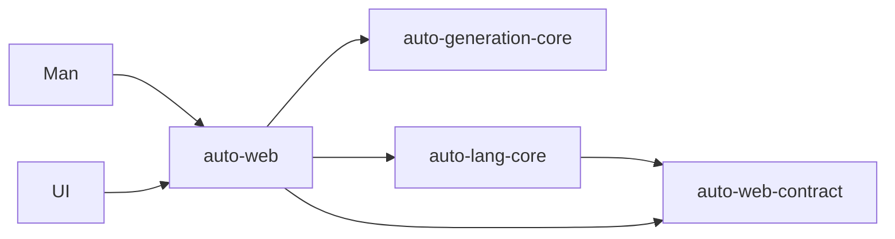

# AutoWeb

> **Status**: active; version0.1.0; independent sibling Git repository (PLAN-890).

AutoWeb owns the existing Web service framework, its HTTP generators, resources,
independent tests and source/Windows delivery. The language repository owns
compiler/VM semantics; UI owns rendering/tools; Man owns CLI/project/dependency
and generic process/installation orchestration.



```text
PLAN-906: auto-web-contract 包单源在语言仓 crates/auto-web-contract；
web/core/ui/man 四方消费同一包（links 守卫防同名双 source）
```

| Component | Responsibility |
|---|---|
| auto-web-contract | Pure versioned config, validation/hash and policy data; no Core/VM/Axum/UI/Man implementation. PLAN-906 起包单源居语言仓 `crates/auto-web-contract`（本仓成员仅 auto-web，经 path 回指消费；交付 receipt owner=auto-lang） |
| auto-web library/runtime | HTTP routing/binding/dispatch/scopes, transport, budgets/observations, file/upload adapters and owned shutdown |
| auto-web generation | HTTP Rust/TypeScript targets, service/client generation and HTTP templates |
| auto-web CLI/delivery | Explicit file service host, source/Windows package and immutable Man installer artifact |

[Architecture](architecture.md), [HTTP contracts](http-contracts.md),
[testing](testing.md), [delivery](delivery.md) are the canonical Web domain source.
The language [pointer](../../../auto-lang/docs/specs/auto-web/project.md) does not
maintain a second Web contract. The inherited language API/885 generation rules
remain linked from those pages rather than being silently redefined.

The central [PLAN-890](../../../auto-lang/docs/plans/archive/890-auto-web-independent-repository-delivery.md)
records independent acceptance and actual final gates separately. Local Git
landing is not remote push, registry publication or new production certification.
